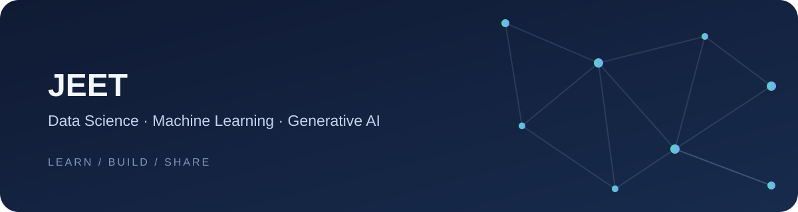

# Hi, I'm Jeet

**Data Science · Machine Learning · Generative AI**

---

## About me

I’m developing practical skills in data science and AI, with a focus on understanding the foundations and applying them through hands-on work.

- **Areas of focus:** data science, machine learning, deep learning, and generative AI
- **Learning:** coursework through Deakin University and The University of Texas at Austin
- **Experience:** data science and ServiceNow
- **Current direction:** building toward AI engineering with a strong foundation in statistics and machine learning

## Focus areas

| Data science | Machine learning | Generative AI |
|:--|:--|:--|
| Explore data and build a sound statistical foundation. | Learn how models work and how to apply them to real problems. | Develop a practical understanding of modern AI systems. |

## Learning path

I’m working through the fundamentals step by step: probability and statistics, machine learning, deep learning, and generative AI. I value understanding the concepts and practicing them in code.

## GitHub

---

*Thanks for stopping by. Explore my repositories to follow what I’m learning and building.*

